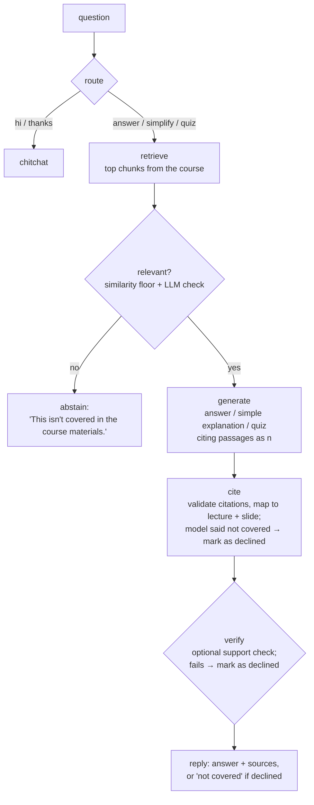

# Course Study Assistant

Our final project for Applied Generative AI.

This is a study assistant that answers questions **only from our course materials**: the lecture slides, the practical notebooks and the activity PDFs. Every answer **cites the lecture and slide (or page)** it came from, and when the course doesn't cover something, it **says "This isn't covered in the course materials"** instead of guessing. It can also explain a topic more simply or write a short practice quiz.

We built it with the tools from class, RAG (embeddings and vector search) inside a LangGraph workflow, and tested it on 50 questions with known answers against a chatbot that can't see the materials.

Team: Sowris Kumar Sripathy, Alfonso Garcia. Original proposal: [`docs/proposal.png`](docs/proposal.png).

## Results

We wrote 50 new questions: 38 that the course covers and 12 that it doesn't, 10 of which were chosen to *sound* like course topics. The assistant runs on a local Llama 3.1 8B, the answers were graded by Llama 3.1 8B, and we re-checked every failed answer by hand. The [report](docs/report.md) and [notebook 05](notebooks/05_evaluation.ipynb) have the details, confidence intervals and caveats.

| | Assistant (Llama + course) | Same Llama, no course |
|---|---|---|
| Answers covered questions correctly (by hand) | **97%** (37/38); 92% on a strict reading | 61% |
| Cites the right lecture | **97%** | n/a |
| Says "not covered" when it isn't | **100%** (12/12) | 33% |
| …for topics that sound like the course (PPO, DPO, FID…) | **100%** (10/10) | 20% |

The gap isn't only about course trivia. On the 33 general-knowledge questions it is still 97% against 70% (91% against 70% on a strict reading). Showing the plain model the course syllabus doesn't close the gap either; it just swaps wrong answers for refusals. You can read some real sessions in [`docs/examples.md`](docs/examples.md).

## Run it

You need [uv](https://docs.astral.sh/uv/), which installs Python 3.12 for you, and about 2 GB of disk for the environment and the embedding model. To actually chat with the assistant you also need a language model: either [Ollama](https://ollama.com) with Llama 3.1 8B (a 4.9 GB download), or a Gemini or OpenAI key. The Docker setup needs Docker Compose 2.24 or newer.

```bash
git clone https://github.com/SowrisKumar/course-study-assistant.git
cd course-study-assistant
uv sync
uv run pytest
```

Everything you need is in the repo. The first run (the tests included) needs an internet connection once, to download the small embedding model (about 90 MB) from Hugging Face. The knowledge base, which is the text of the course materials already extracted and cleaned, is `data/processed/documents.jsonl`, and [`notebooks/01_ingest_explore.ipynb`](notebooks/01_ingest_explore.ipynb) walks through it.

### Language models

The assistant can use any of four models. The local ones need no key. For the cloud ones, copy `.env.example` to `.env` and add your key.

| Backend | Setup |
|---|---|
| `ollama` (Llama 3.1, local, free) | install [Ollama](https://ollama.com), then `ollama pull llama3.1:8b` |
| `flan` (flan-t5, local, free) | nothing to set up; downloads about 1 GB on first use |
| `gemini` (free tier) | `GEMINI_API_KEY` from [AI Studio](https://aistudio.google.com) |
| `openai` (paid) | `OPENAI_API_KEY` |

```bash
uv run python -m study_assistant.llm --check
uv run python -m study_assistant.llm -b ollama "What is a GAN?"
```

## Try it

```bash
# chat in the terminal (uses the local Llama 3.1 through Ollama)
uv run python -m study_assistant.chat
# the same, but also print each step the assistant takes
uv run python -m study_assistant.chat -v
# ask one question with Gemini instead (needs GEMINI_API_KEY in .env)
uv run python -m study_assistant.chat -b gemini "Quiz me on GANs"
```

```
you> Why do transformers need positional encodings?
Transformers need positional encodings because they are permutation-equivariant, meaning they don't
inherently understand the order of the input tokens. ... Without positional encodings, the model would
treat "the dog bit the man" and "the man bit the dog" as the same input. [1]

Sources:
[1] Lecture 9 · Module 8 - Practical: Building a GPT from Scratch, cells 21-22 (6. Token and positional embeddings)

you> What is mode collapse in GANs?
This isn't covered in the course materials.
```

Here is how a question moves through the workflow:



## Reproducing the evaluation

```bash
# re-run every configuration into a new eval/runs/<date>-<commit>/ folder
# (about 2¾ hours on an M2; needs Ollama and llama3.1:8b; eval/results/ is never touched)
./scripts/run_evaluation.sh
# analyse the reported run: hand-checked and strict scores, 95% intervals, McNemar tests
uv run python eval/analysis.py
# the same analysis for your own run
uv run python eval/analysis.py --results eval/runs/<folder>
```

Every run adds rows to [`eval/experiment_log.csv`](eval/experiment_log.csv), one per build and configuration, with the code version and the model digest. [Notebook 06](notebooks/06_experiment_log.ipynb) charts all the models and builds side by side.

## Run it as a web API (FastAPI + Docker)

The same assistant is also available as an HTTP API (`src/study_assistant/api.py`, following the class's `sps_genai` pattern):

| Endpoint | Body | Returns |
|---|---|---|
| `POST /ask` | `{"question": "...", "trace": false}` | answer with numbered sources (lecture + slide), or "not covered" |
| `POST /explain` | `{"topic": "..."}` | a simpler explanation, with sources |
| `POST /quiz` | `{"topic": "..."}` | a 3-question practice quiz, with sources |
| `GET /health` | | model, retriever, knowledge-base size (503 if the model isn't reachable) |

Interactive docs are at `/docs`.

**Without Docker:**

```bash
uv run uvicorn study_assistant.api:app --port 8000
```

**With Docker** (the image holds the code, the knowledge base and the embedding model, but not the language model):

```bash
docker compose up --build
```

```bash
curl -s -X POST localhost:8000/ask -H 'content-type: application/json' -d '{"question": "What gates does a GRU have?"}'
```

By default the container uses the Ollama running on your own machine (run `ollama pull llama3.1:8b` first). On a Mac that is much faster than running Ollama inside Docker. To use Gemini instead, put `GEMINI_API_KEY` in `.env` and run `LLM_BACKEND=gemini docker compose up --build`. You can also set `RETRIEVER` and `VERIFY` (see `docker-compose.yml`).

## Status

| Step | What | Status |
|---|---|---|
| 1 | Knowledge base: slides, notebooks and PDFs turned into 538 documents with citation info | ✅ |
| 2 | Chunking + retrieval: TF-IDF, BM25, dense, hybrid compared ([notebook 02](notebooks/02_retrieval.ipynb)) | ✅ |
| 3 | LLM backends: OpenAI, Gemini, Ollama (Llama 3.1), flan-t5 ([notebook 03](notebooks/03_llm_backends.ipynb)) | ✅ |
| 4 | LangGraph assistant: answer / simplify / quiz / abstain, with citations ([notebook 04](notebooks/04_assistant_demo.ipynb)) | ✅ |
| 5 | Evaluation: 50 questions, RAG vs no-RAG ([notebook 05](notebooks/05_evaluation.ipynb), [questions](eval/QUESTIONS.md)) | ✅ |
| 6 | Optional support check for citations that don't back the answer (`--verify`), and the **[final report](docs/report.md)** | ✅ |
| 7 | HTTP API (FastAPI) and Docker image | ✅ |

The **final report** is [`docs/report.md`](docs/report.md), and [`docs/design.md`](docs/design.md) explains our design decisions and why we made them.

## Layout

```
data/processed/documents.jsonl   the knowledge base
src/study_assistant/             the code: ingest/ (knowledge base), chunking.py, retrieval.py, llm/,
                                 assistant.py (LangGraph workflow), prompts.py, chat.py, api.py (FastAPI)
notebooks/                       step-by-step walkthroughs
eval/                            questions with verified answers; results, hand labels, analysis,
                                 experiment_log.csv (every build and model ever evaluated)
scripts/run_evaluation.sh        reproduces every evaluation number
tests/                           tests
docs/                            proposal, design log, report
eval/QUESTION_REVIEW.md          review of the 50 questions against the course text
Dockerfile, docker-compose.yml   the API in a container
```
