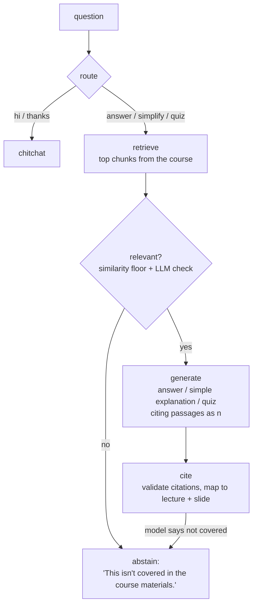

# Course Study Assistant — Applied Generative AI (Final Project)

A study assistant that answers questions **only from our course materials** (lecture slides, practical notebooks, activity PDFs), **cites the lecture and slide/page** each answer came from, and **says "this isn't covered in the course"** instead of guessing. It can also explain a topic more simply and generate a short practice quiz.

Built with the tools from class: RAG (embeddings + vector search) and a LangGraph workflow, evaluated on ~50 questions with known answers against a chatbot that can't see the materials.

Team: Sowris Kumar Sripathy, Alfonso Garcia. Original proposal: [`docs/proposal.png`](docs/proposal.png).

## Try it

```bash
uv run python -m study_assistant.chat            # chat in the terminal (uses local Llama 3.1 via Ollama)
uv run python -m study_assistant.chat -v         # also show each step the assistant takes
uv run python -m study_assistant.chat -b gemini "Quiz me on GANs"
```

```
you> Why do transformers need positional encodings?
Transformers need positional encodings because the self-attention mechanism ... is invariant to the order of the input tokens. ... [1]

Sources:
[1] Lecture 9 · Module 9 – Transformer Architecture and Advanced GAN, slide 6

you> What is mode collapse in GANs?
This isn't covered in the course materials.
```

How it works:



## Run it

Requires [uv](https://docs.astral.sh/uv/).

```bash
git clone https://github.com/SowrisKumar/course-study-assistant.git
cd course-study-assistant
uv sync
uv run pytest
```

Everything needed is in the repo. The first run downloads the small embedding model (~90 MB) from Hugging Face. The knowledge base (the course materials' text, already extracted and cleaned) is `data/processed/documents.jsonl`. Walk through it in [`notebooks/01_ingest_explore.ipynb`](notebooks/01_ingest_explore.ipynb).

### Language models

The assistant can use any of four models. Local ones need no key; for cloud ones copy `.env.example` to `.env` and add a key.

| Backend | Setup |
|---|---|
| `ollama` (Llama 3.1, local, free) | install [Ollama](https://ollama.com), then `ollama pull llama3.1:8b` |
| `flan` (flan-t5, local, free) | nothing |
| `gemini` (free tier) | `GEMINI_API_KEY` from [AI Studio](https://aistudio.google.com) |
| `openai` (paid) | `OPENAI_API_KEY` |

```bash
uv run python -m study_assistant.llm --check
uv run python -m study_assistant.llm -b ollama "What is a GAN?"
```

## Status

| Step | What | Status |
|---|---|---|
| 1 | Knowledge base: slides / notebooks / PDFs → 507 documents with citation info | ✅ |
| 2 | Chunking + retrieval: TF-IDF, BM25, dense, hybrid compared ([notebook 02](notebooks/02_retrieval.ipynb)) | ✅ |
| 3 | LLM backends: OpenAI, Gemini, Ollama (Llama 3.1), flan-t5 ([notebook 03](notebooks/03_llm_backends.ipynb)) | ✅ |
| 4 | LangGraph assistant: answer / simplify / quiz / abstain, with citations ([notebook 04](notebooks/04_assistant_demo.ipynb)) | ✅ |
| 5 | Evaluation: 50 questions ([review them](eval/QUESTIONS.md)) and harness ready; full run next | ⏳ |
| 6 | Improvements and write-up | |

Design decisions and their reasons: [`docs/design.md`](docs/design.md).

## Layout

```
data/processed/documents.jsonl   the knowledge base
src/study_assistant/             the code: ingest/ (knowledge base), chunking.py, retrieval.py, llm/,
                                 assistant.py (LangGraph workflow), prompts.py, chat.py
notebooks/                       step-by-step walkthroughs
eval/                            questions with verified answers; evaluation results
tests/                           tests
docs/                            proposal, design log
```
