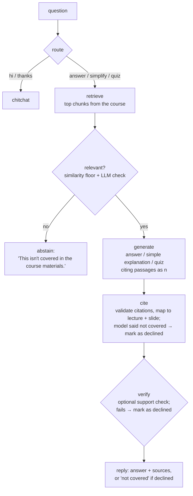

# Course Study Assistant — Applied Generative AI (Final Project)

A study assistant that answers questions **only from our course materials** (lecture slides, practical notebooks, activity PDFs), **cites the lecture and slide/page** each answer came from, and **says "this isn't covered in the course"** instead of guessing. It can also explain a topic more simply and generate a short practice quiz.

Built with the tools from class: RAG (embeddings + vector search) and a LangGraph workflow, evaluated on ~50 questions with known answers against a chatbot that can't see the materials.

Team: Sowris Kumar Sripathy, Alfonso Garcia. Original proposal: [`docs/proposal.png`](docs/proposal.png).

## Results

50 new questions: 38 the course covers and 12 it doesn't, 10 of which deliberately *sound* like course topics. Local Llama 3.1 8B, graded by Llama 3.1 8B, and every failed answer re-checked by hand. Details, intervals and caveats are in the [report](docs/report.md) and [notebook 05](notebooks/05_evaluation.ipynb).

| | Assistant (Llama + course) | Same Llama, no course |
|---|---|---|
| Answers covered questions correctly (by hand) | **97%** (37/38); 92% on a strict reading | 61% |
| Cites the right lecture | **97%** | – |
| Says "not covered" when it isn't | **100%** (12/12) | 33% |
| …for topics that sound like the course (PPO, DPO, FID…) | **100%** (10/10) | 20% |

The gap isn't just course trivia: on the 33 general-knowledge questions it is 97% vs 70% (91% vs 70% on a strict reading). Giving the plain model the course syllabus doesn't close it either; it just trades wrong answers for refusals. Example sessions: [`docs/examples.md`](docs/examples.md).

## Try it

```bash
uv run python -m study_assistant.chat            # chat in the terminal (uses local Llama 3.1 via Ollama)
uv run python -m study_assistant.chat -v         # also show each step the assistant takes
uv run python -m study_assistant.chat -b gemini "Quiz me on GANs"
```

```
you> Why do transformers need positional encodings?
Transformers need positional encodings because the self-attention mechanism ... is invariant to the order of the input tokens. ... [1]

Sources:
[1] Lecture 9 · Module 9 – Transformer Architecture and Advanced GAN, slide 6

you> What is mode collapse in GANs?
This isn't covered in the course materials.
```

How it works:



## Run it

Requires [uv](https://docs.astral.sh/uv/).

```bash
git clone https://github.com/SowrisKumar/course-study-assistant.git
cd course-study-assistant
uv sync
uv run pytest
```

Everything needed is in the repo. The first run (tests included) needs internet once, to download the small embedding model (~90 MB) from Hugging Face. The knowledge base (the course materials' text, already extracted and cleaned) is `data/processed/documents.jsonl`. Walk through it in [`notebooks/01_ingest_explore.ipynb`](notebooks/01_ingest_explore.ipynb).

### Language models

The assistant can use any of four models. Local ones need no key; for cloud ones copy `.env.example` to `.env` and add a key.

| Backend | Setup |
|---|---|
| `ollama` (Llama 3.1, local, free) | install [Ollama](https://ollama.com), then `ollama pull llama3.1:8b` |
| `flan` (flan-t5, local, free) | nothing |
| `gemini` (free tier) | `GEMINI_API_KEY` from [AI Studio](https://aistudio.google.com) |
| `openai` (paid) | `OPENAI_API_KEY` |

```bash
uv run python -m study_assistant.llm --check
uv run python -m study_assistant.llm -b ollama "What is a GAN?"
```

### Reproducing the evaluation

```bash
./scripts/run_evaluation.sh        # re-runs every configuration into a new eval/runs/<date>-<commit>/ folder
                                   # (~2¾ h on an M2, needs Ollama + llama3.1:8b); eval/results/ is never touched
uv run python eval/analysis.py     # the reported run: hand-checked and strict scores, 95% intervals, McNemar tests
uv run python eval/analysis.py --results eval/runs/<folder>   # the same for your own run
```

Every run is appended to [`eval/experiment_log.csv`](eval/experiment_log.csv) (one row per build and configuration, with the code version and model digest). [Notebook 06](notebooks/06_experiment_log.ipynb) charts all models and builds side by side.

## Status

| Step | What | Status |
|---|---|---|
| 1 | Knowledge base: slides / notebooks / PDFs → 538 documents with citation info | ✅ |
| 2 | Chunking + retrieval: TF-IDF, BM25, dense, hybrid compared ([notebook 02](notebooks/02_retrieval.ipynb)) | ✅ |
| 3 | LLM backends: OpenAI, Gemini, Ollama (Llama 3.1), flan-t5 ([notebook 03](notebooks/03_llm_backends.ipynb)) | ✅ |
| 4 | LangGraph assistant: answer / simplify / quiz / abstain, with citations ([notebook 04](notebooks/04_assistant_demo.ipynb)) | ✅ |
| 5 | Evaluation: 50 questions, RAG vs no-RAG ([notebook 05](notebooks/05_evaluation.ipynb), [questions](eval/QUESTIONS.md)) | ✅ |
| 6 | Support check for unsupported citations (optional, `--verify`) + **[final report](docs/report.md)** | ✅ |

**Final report: [`docs/report.md`](docs/report.md).** Design decisions and their reasons: [`docs/design.md`](docs/design.md).

## Layout

```
data/processed/documents.jsonl   the knowledge base
src/study_assistant/             the code: ingest/ (knowledge base), chunking.py, retrieval.py, llm/,
                                 assistant.py (LangGraph workflow), prompts.py, chat.py
notebooks/                       step-by-step walkthroughs
eval/                            questions with verified answers; results, hand labels, analysis,
                                 experiment_log.csv (every build and model ever evaluated)
scripts/run_evaluation.sh        reproduces every evaluation number
tests/                           tests
docs/                            proposal, design log
```
