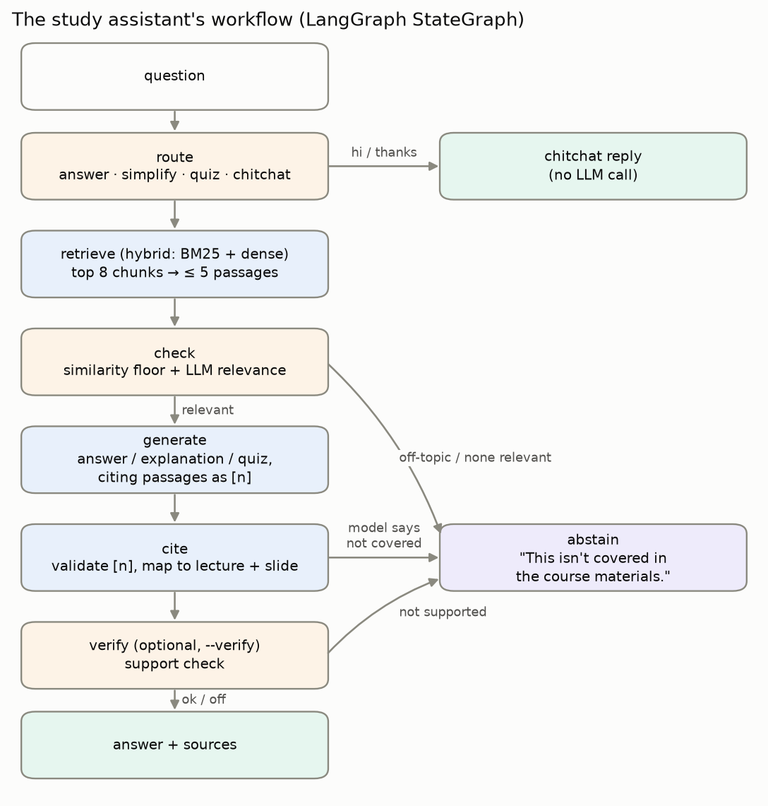

# A Course-Grounded Study Assistant for Applied Generative AI

**Team:** Sowris Kumar Sripathy, Alfonso Garcia · **Code:** https://github.com/SowrisKumar/course-study-assistant

## Abstract

General-purpose chatbots are good at answering course questions, but they can't tell you *where in the course* an answer comes from. They also answer topics the course never covered with exactly the same confidence. We built a study assistant that answers only from our own course materials: the lecture slides, the practical notebooks and the activity PDFs. Every answer cites the lecture and slide (or notebook section) it came from, and when the materials don't cover something, the assistant says *"This isn't covered in the course materials"* instead of guessing. It can also explain a topic in simpler terms or write a short practice quiz. Under the hood it is a RAG pipeline inside a LangGraph workflow, running on Llama 3.1 8B on a laptop.

We tested it on 50 new questions: 38 that the course covers and 12 that it doesn't. We compared it with the same model answering without the materials.

| | With the course materials | Same model, without them |
|---|---|---|
| Covered questions answered correctly (checked by hand) | **97%** (37/38) | 61% (23/38) |
| …on a strict reading of two borderline answers | 92% (35/38) | 61% |
| …by the automatic metric alone (after the question review, Section 6) | 97% (95% before) | 50% (47% before) |
| Answers citing the right lecture | **97%** | n/a |
| Uncovered questions declined | **100%** (12/12) | 33% (4/12) |
| …of which topics that *sound* like course content (near-misses + a trap) | **100%** (10/10) | 20% (2/10) |

Across all 50 questions the assistant got 49 right and the plain model 27. They disagree on 24 questions, and the assistant wins 23 of them (exact McNemar test, p < 0.001). The 97% gives two borderline answers the benefit of the doubt (Section 6). If we count those as wrong, the score is 92% and the assistant still wins 22 to 2 (p < 0.001). With this few questions every percentage comes with a wide interval; for the 97% it is 87–100%.

Four things we learned seem worth sharing beyond this project. First, an 8B model makes an unreliable grader, in both directions: we had to redesign the grading and still read every failed answer by hand. Second, our LLM relevance check did nothing measurable. In the default system it never declined a question; every abstention came from the answer prompt or a similarity floor, and turning the check off gave the same results. Third, the comparison wasn't rigged in our favour. The course materials help on general-knowledge questions too (97% vs 70%, or 91% vs 70% on the strict reading, where the difference stops being statistically significant), and giving the plain model the course syllabus doesn't close the gap; it only swaps wrong answers for refusals (Section 6). Fourth, a support check we added after answering found nothing left to catch on the evaluation set (Section 7), and our first verdict on its two variants turned out to be wrong until we labelled the development answers by hand.

---

## 1. Problem and goals

Our midterm proposal (`docs/proposal.png`) set out five goals. We kept all five and turned each into something we could measure:

1. **Answer only from the course materials.**
2. **Show which lecture the answer came from,** down to the slide, notebook section or page, not just the file name.
3. **Say "not covered" instead of guessing.**
4. **Explain a topic more simply, and make a short practice quiz.**
5. **Evaluate on about 50 questions with known answers** (correctness, citations, and admitting what it doesn't know) against a chatbot that can't see the materials.

We had moved the FastAPI and Docker deployment to the end of the project. It is now done (Section 9).

## 2. What we used from the class

| Course material | Where it shows up |
|---|---|
| `shared/research_ingest.py` | Chunking, sentence-transformer embeddings (`all-MiniLM-L6-v2`), citation metadata on every chunk |
| `RAG_primer_fast.ipynb` | TF-IDF retrieval (one of our four retrievers) and the 5 stages of RAG |
| `campus_help_desk_rag.ipynb`, `langgraph_intro.ipynb` | The LangGraph `StateGraph` pattern: router → nodes → conditional edges, plus a "don't know" fallback |
| `M3_Prompting_Strategies_colab.ipynb`, Lecture 3 | Structured prompting: system prompts with explicit rules and fixed output formats (`RELEVANT: 1, 3`, `SCORE: 2`) |
| `llm_evals.ipynb`, `llm_as_judge_solution.ipynb` | Evaluation tiers, from rules (key facts) up to LLM-as-judge, and the warning that judges are unreliable, which we confirmed |
| Lectures 2, 3, 9 | Embeddings, RAG vs fine-tuning, and transformers (the models we use) |
| `Module 1 Custom Setup Guide` | `uv` project management, as used in this repo |
| `sps_genai` (class FastAPI + Docker project) | The HTTP API and the Docker image: a FastAPI app served by uvicorn, with `uv sync --frozen` in a slim Python image |

## 3. Knowledge base (Step 1)

We turned 48 course files into **538 documents**. Each one is a natural unit of the material and carries the information needed to cite it (`src/study_assistant/ingest/`):

| Source | One document is | How it's handled |
|---|---|---|
| 11 slide decks (`.pptx`) | a slide | title, text boxes, tables and speaker notes; slide-number fields removed |
| 28 notebooks | an *explanation plus its code*, with a heading breadcrumb | outputs and `pip install` lines dropped |
| 7 PDFs (activities, setup guide) | a page | PyMuPDF in reading order; headers, footers, URLs and page counters removed |
| 2 extended decks for Lectures 10 and 11 (28 + 31 slides, **images only**) | a slide | OCR with RapidOCR, rebuilding the layout so side-by-side boxes don't get mixed together |

Building it surfaced several problems. The notebooks and lectures are numbered differently: `Module_4_Practical_VAE.ipynb`, for instance, is the practical for **Lecture 5**. We wrote an explicit catalogue that maps each notebook to its lecture by content, so citations send students to the right place. The pypdf library dropped the spaces in code (`importtorch.nnasnn`), so we switched to PyMuPDF, and we needed position-based reading order to keep each code listing next to its heading. We also flagged 43 title and section-divider documents (42 slides and one notebook section) and kept them out of the index, because otherwise they out-rank the slides that actually explain a topic. Finally, the extended Lecture 11 deck was missing at first. An AI-assisted review of the project found it (see the note on AI use in Section 8), and it mattered: that deck names PPO, which one of our "not covered" questions had asked about (Section 6).

The repo doesn't include the original course files (slides, notebooks, PDFs), but it **does include the text we extracted from them** (`data/processed/documents.jsonl`). Quotations from that text also appear in the saved answers (`eval/results/`, `eval/archive/`, `eval/support_check/`), the notebook outputs and the question set (`eval/QUESTIONS.md`). That's what lets the project run straight from a clone. The text is the instructor's material; the team decided to keep the repository public.

Two limitations remain. Equations and diagrams that exist only as images are lost (the VAE loss formula, for example), and the OCR only approximates Greek letters.

## 4. Retrieval (Step 2)

The embedding model reads at most 256 tokens, but 185 of the 249 notebook sections were longer than that, some up to 4,800 tokens. We split them at paragraph and code-block boundaries, measuring length with the model's own tokenizer. Each chunk starts with a `title › section` header, because a fragment of code means a lot more when it's labelled "VAE › Training". That gives **1,237 chunks**, none over the limit and with no text lost; both properties are tested.

We built four retrievers behind one interface: TF-IDF (from the class primer), BM25, dense retrieval with MiniLM embeddings, and a hybrid that merges BM25 and dense rankings with Reciprocal Rank Fusion. On 30 development questions whose answers we had verified by searching the course text, keyword search was perfect whenever the question used the course's own term, and fell apart when it didn't. Here is how often each method found the right material in its top 5 results for paraphrased questions:

| TF-IDF | BM25 | Dense | Hybrid |
|---|---|---|---|
| 60% | 80% | **100%** | 80% |

A student who doesn't yet know the right term needs retrieval that works on meaning.

We also found that similarity scores can't tell "covered" from "not covered". "What is the capital of France?" scored *higher* than the weakest real question (0.43 vs 0.37), because the extended Lecture 11 deck happens to use it as an example prompt. The near-miss "mode collapse" scored higher than six real questions. That's why we added an LLM relevance check instead of relying on a threshold, although Section 6 shows the check didn't help in practice.

## 5. The assistant (Steps 3–4)

All language models sit behind one interface, `generate(prompt, system)`, with four backends: OpenAI, Gemini (free tier), Llama 3.1 8B through Ollama (local, and used for all our results), and flan-t5, the model from class, as a weak baseline. Everything runs at temperature 0 with a fixed seed. When we re-ran the evaluation answers we checked, they came out identical byte for byte. That isn't guaranteed, though: some long free-form answers (for example a "simplify" explanation in notebook 04) came out worded differently on a re-run, and once without a citation, which the assistant then flags as uncited. Rate limits are retried with backoff.

The workflow is a LangGraph graph (`assistant.py`):



| Step | What it does |
|---|---|
| route | Rule-based, like the class router: quiz, simplify, chitchat or answer. Only explicit phrases trigger "simplify", so a question about "simple RNNs" stays a normal question. |
| retrieve | Hybrid retrieval. Chunks from the same document are merged so each source is cited once. |
| check | A cosine-similarity floor drops obviously off-topic questions without calling the LLM. One LLM call then grades all the passages (`RELEVANT: 1, 3`). |
| generate | A prompt for each mode: use only the passages, cite `[n]` after each fact, and reply with exactly the "not covered" sentence if the passages aren't enough. |
| cite | Citations to passages that weren't shown are dropped and the rest renumbered; code such as `outputs[0]` is left alone. Citations become labels like "Lecture 9 · Module 9 – Transformer Architecture…, slide 6", and an answer with no citation is flagged. |
| verify | An optional support check, off by default (Section 7). |

Here is a real session. With `chat -v`, the assistant prints one trace line for each step of the workflow. [`docs/examples.md`](examples.md) has this session in full, along with a declined near-miss and a practice quiz.

```text
you> Why use sinusoidal positional encoding rather than just adding the position index?
  · route: mode=answer
  · retrieve (hybrid): 8 chunks -> 5 passages   [1] Lecture 9, slide 7 (0.58) [2] slide 8 (0.47) ...
  · check: grader says relevant=[1, 2, 4]
  · generate (ollama/llama3.1:8b, 14.6s)
  · cite: 2 source(s) cited

We should be careful about how we encode the positions, as simply adding the position index can result in
large values that might interfere with the token embedding [1]. Using sinusoidal positional encoding addresses
this problem and conserves relative distances between positions [1]. This encoding scheme keeps the dimension
fixed and never runs out of encodings, no matter how long the context [2].

Sources:
[1] Lecture 9 · Module 9 – Transformer Architecture and Advanced GAN, slide 7
[2] Lecture 9 · Module 9 – Transformer Architecture and Advanced GAN, slide 8
```

To try it yourself: `uv run python -m study_assistant.chat -v`.

## 6. Evaluation (Step 5)

We wrote 50 new questions for the evaluation (`eval/QUESTIONS.md`), none of them reused from development:

| Type | Count |
|---|---|
| Answerable, using the course's terms | 31 |
| Answerable, paraphrased | 7 |
| Not covered: near-misses that sound like course topics (label smoothing, PPO's clipped objective, VQ-VAE, Stable Diffusion, MoE, FID, L1/L2, DPO, GRPO) | 9 |
| Not covered: a trap ("Everest" appears in toy demo data, but its boiling point doesn't) | 1 |
| Not covered: off-topic | 2 |

Every reference answer was written from the slide it cites. Automated tests check that every key fact appears in the right lecture, that no key fact just repeats the question, and that no "not covered" topic appears anywhere in the course. Those checks caught mistakes in our own drafts. After the audit we also replaced one near-miss that the course turned out to half-cover (vanishing gradients) and tightened 11 key-fact lists.

We ran these systems:
- the assistant (RAG) and the plain model (no RAG), for both Llama 3.1 8B and flan-t5-base
- the assistant with dense and with hybrid retrieval
- ablations of the main system, each changing one thing: relevance check off, similarity floor off, less context (3 passages), more context (8 passages), and the support check on (Section 7)

The plain baseline gets the same "you are the course's study assistant; say not covered if…" prompt, just without the materials. We also built a fairer version of it that sees the course **syllabus** (the outline of every lecture and lab, about 4,000 tokens), with a strict and a lenient instruction.

We measured three things. For abstention, we counted the share of not-covered questions declined and the share of covered questions wrongly declined. For citations, we checked whether answers cite the right lecture. For correctness, we scored all 38 covered questions, counting a refusal as wrong, by combining the two evaluation tiers from class: key-fact recall and LLM-as-judge.

The grader needed fixing. Llama 3.1 8B graded the answers, and our first version showed it only the reference answer. It then marked down correct details from the course that our short references happened to leave out. We checked six such cases, and all six are in the course text; one is the diffusion practical's `denoise(noisy_images, noise_rates, signal_rates)`. That biased the comparison *against* RAG. The second version also shows the grader the most relevant excerpts of the right lecture, the same for every system. That fixed those cases, but now the grader was **too lenient with one-word answers**: flan-t5's reply "squeeze" got full marks. So our main metric requires both the grader's verdict *and* at least half the key facts. We designed this metric after seeing first results, so it isn't a pre-registered measure, and we report all three versions side by side below.

The grader was also inconsistent: two almost identical answers to q02, from the hybrid and dense runs, scored 2 and 1. So we re-read every answer the main metric marked as not correct, in every Llama configuration, against its reference and the lecture. We also re-read every answer it marked correct for the main system and the three no-course baselines. Only one of those passes was overturned: q34 of the lenient-syllabus baseline, downgraded to partial (two had been overturned before the question review). The re-reading was done during development with the AI coding assistant (see the note on AI use in Section 8). The file `eval/hand_labels.json` records every overturned or borderline verdict with its reason; passes confirmed on re-reading aren't listed. Each label is tied to a hash of the exact answer it judged, so a re-run never inherits an old verdict. Because the people (and the tool) that built the system also made this check, it isn't blind.

Two of the main system's answers got the benefit of the doubt. For q02 the answer uses the general definition of an intrinsic hallucination ("unfaithful to the source") rather than the course's ("wrongly summarises the source"). For q29 it repeats the practical's line that top-k "truncates the long tail", but never says that sampling is limited to the k most likely tokens. We treat the same answers the same way in every configuration. The **strict reading** counts both as wrong, and we report both readings. A blind second labeller would settle these better than we can.

### Results


| | Llama + course (hybrid) | Llama + course (dense) | Llama, no course | flan-t5 + course | flan-t5, no course |
|---|---|---|---|---|---|
| **Correct, checked by hand** | **97%** | 92% | 61% | n/a | n/a |
| Correct, strict reading (borderline = wrong) | 92% | 87% | 61% | n/a | n/a |
| Correct, main metric (v2 + key facts) | 97% | 84% | 50% | 24% | 0% |
| …before the question review | 95% | 79% | 47% | 24% | 0% |
| Correct, judge v2 alone | 100% | 84% | 58% | 55% | 13% |
| Correct, judge v1 alone | 82% | 71% | 45% | 16% | 0% |
| Key facts present | 89% | 89% | 62% | 29% | 0% |
| Covered questions wrongly refused | 0% | 5% | 3% | 8% | 50% |
| Not covered → declined (12) | **100%** | 92% | 33% | 67% | 50% |
| Near-miss or trap → declined (10) | **100%** | 90% | 20% | 60% | 60% |
| Cites the right lecture | 97% | 100% | n/a | (3 answers cited) | n/a |
| Seconds per question (M2 laptop) | 14 | 13 | 7 | 1 | <1 |

The next table gives the hand-checked scores with 95% Wilson intervals, plus a paired test of each system against the main one over all 50 questions. An answerable question counts if it was answered correctly, and a not-covered one if it was declined. All of it comes from `eval/analysis.py`.

| | Correct (38) | Declined (12) | All 50 | vs main: main wins / loses | exact McNemar p |
|---|---|---|---|---|---|
| **Main: Llama + course, hybrid** | 97% [87–100] | 100% [76–100] | 98% [90–100] | n/a | n/a |
| Llama + course, dense | 92% [79–97] | 92% [65–99] | 92% [81–97] | 4 / 1 | 0.38 |
| Relevance check off | 97% [87–100] | 100% [76–100] | 98% [90–100] | 1 / 1 | 1 |
| Llama, no course | 61% [45–74] | 33% [14–61] | 54% [40–67] | 23 / 1 | < 0.001 |

The clearest result, and the only difference this test set is big enough to establish, is that the course materials make the assistant both more accurate and more honest. Without them, the model confidently answers 8 of the 10 near-miss and trap questions (PPO, DPO, FID and so on), so a student would come away believing those topics were taught. It also refuses one of the five questions that only the course can answer (the MIT/Stanford productivity study, q01) and gets course-specific facts wrong, such as naming Conda instead of `uv` or inventing evaluation "tiers".

For the main system, the automatic metric and the hand check now agree (37/38). For the other systems the automatic metric under-counts by up to 4 questions in the main comparison (3 for dense, 4 for no course, and 6 for the lenient-syllabus baseline), mostly because a key-fact list was too strict for a correct paraphrase. The ranking of systems is the same either way.

This test set can't settle hybrid versus dense retrieval. Hybrid wins 4 questions and loses 1 (p = 0.38). We made hybrid the default because it never wrongly refused, but we chose it on these same questions, so its numbers are a little optimistic; dense is the unselected baseline.

The LLM relevance check did nothing measurable. In every run with the similarity floor on, which is the default, it accepted at least one passage for every question and never declined anything. (With the floor turned off, it did decline one off-topic question, Wimbledon.) All 12 abstentions came either from the similarity floor (the 2 off-topic questions) or from the answer prompt (the other 10). Turning the check off left the results within one question each way: one answer got better and one got worse. Meanwhile it costs an extra LLM call per question, 14 seconds per answer instead of 10.

Retrieval isn't the bottleneck here. Both retrievers put the right lecture (or lab) in the top 3 passages for all 38 covered questions, so the remaining errors come from generation. And flan-t5 is simply too small for this task. RAG lifts it from 0% to 24%, but its answers are a few words long and almost never cite anything. We didn't hand-check its runs.

### Question review (after the results)

After the evaluation, an AI-assisted review (Claude, in a separate session) checked all 50 questions against the course text; the full review is in [`eval/QUESTION_REVIEW.md`](../eval/QUESTION_REVIEW.md). It confirmed all 12 "not covered" labels. GRPO's idea of an advantage is partly touched on in the RL practical, and PPO is named but never explained, but both are still fair near-misses. It also found six grading problems, which we fixed:
- q29's key facts rejected the GPT practical's own sentence about top-k sampling
- q20's key facts left out the core idea (a change of variables)
- q07's were too strict
- q08's were too loose
- q13's gold lectures were missing Lecture 6
- q32 was labelled a paraphrase but uses the course term

The review also found that our key-fact matcher only looked at the start of words, so "wer" matched "were" and "uv" matched "uvicorn". Phrases now match as whole words unless they're marked as stems.

We re-scored the existing answers rather than re-running anything; the originals are archived in `eval/archive/before_question_review/`. Because we made these corrections after seeing the results, the table shows both versions:

| Automatic main metric | Before the review | After |
|---|---|---|
| Llama + course, hybrid (main) | 95% | 97% |
| Llama + course, dense | 79% | 84% |
| Llama, no course | 47% | 50% |
| Llama, no course, sees the syllabus (lenient) | 29% | 26% |

Several things didn't change: the hand-checked and strict scores (they already judged these answers by reading them), every significance test, and the ranking of systems. We kept q29 *borderline* in the strict reading. The key-fact fix corrects the automatic metric, but not our judgement that the answer never says "only the k most likely tokens".

### Ablations: which parts of the pipeline matter?

Each row changes one thing in the main system. Correctness is by hand, and p is the exact McNemar test against the main system over all 50 questions (`eval/analysis.py`).

| | Correct (38) | Declined (12) | Seconds / question | p vs main |
|---|---|---|---|---|
| **Main system** | **97%** | **100%** | 14 | n/a |
| Relevance check off | 97% | 100% | 10 | 1 |
| Similarity floor off | 97% | 100% | 14 | 1 |
| Less context (3 passages) | 92% | 100% | 9 | 0.5 |
| More context (8 passages) | 97% | 92%* | 19 | 1 |
| Support check on (concept) | 97% | 100% | 18 | 1 |

\* It answered the L1/L2 near-miss, but only to say the course "does not mention" it and to point to dropout, with a citation. That is effectively a decline, but the refusal detector counts it as an answer.

None of these changes beats the default by a significant margin, and two parts of the pipeline turn out to be dead weight on this question set. The relevance check never declines anything in the default system, and the similarity floor only saves LLM calls on the two off-topic questions (without the floor, the answer prompt caught one of them and the relevance check the other). The answer prompt does all the real work of declining. Using less context costs accuracy (q17 becomes wrong and q23 loses an input), while more context costs time. Retrieving 8 chunks and showing 5 passages is a reasonable middle ground, not a proven optimum.

### Was the baseline set up to lose?

We checked this two ways.

The first was to separate course-specific questions from general-knowledge ones. Five questions can only be answered from this course's own material: the MIT/Stanford study (q01), the course's package manager (q03), the word-chain toy example (q34), the tiers in the evaluation lab (q35), and the stages in the RAG primer (q37). The other 33 are general machine-learning knowledge.

| | General knowledge (33) | Course-specific (5) |
|---|---|---|
| Llama + course | **97%** | **100%** |
| Llama, no course | 70% | 0% |

The course helps with general questions too (10 wins, 1 loss, p = 0.012). On the strict reading it's 91% vs 70%, with 9 wins and 2 losses and p = 0.065: still a large gap, but no longer statistically significant with only 33 questions. We picked the five course-specific questions after seeing results; the audit's own list, which adds q38, gives the same picture.

The second was to give the plain model the syllabus, so it can judge for itself what the course covers:

| | Correct (38, by hand) | Covered questions refused | Not covered → declined (12) | All 50 handled |
|---|---|---|---|---|
| **Llama + course (main)** | **97%** | 0% | **100%** | **98%** |
| Llama, no course | 61% | 3% | 33% | 54% |
| …sees the syllabus, strict ("decline if not in the outline") | 11% | 84% | 100% | 32% |
| …sees the syllabus, lenient ("decline only if clearly outside") | 42% | 37% | 83% | 52% |

The syllabus doesn't rescue the baseline; it only moves it along a trade-off. With the strict wording, the model refuses 32 of the 38 covered questions, including topics plainly in the outline such as GRUs, Bayes' theorem and hallucinations. With the lenient wording it answers more, but still refuses 14 covered questions and answers two near-misses (label smoothing and VQ-VAE). Either way it handles about half the questions or fewer, against 98% for the assistant (p < 10⁻⁶ in both cases). Knowing the syllabus isn't enough. To answer *from* the course, the model has to see the course.

As for failures, the main system's one remaining miss is a generic answer that misses the course's specific point. For q19 (class-conditional GANs) it says to "condition on the label" but not how the course does it, which is by feeding one-hot labels to both the generator *and* the critic. The other configurations show three more kinds of failure. The most worrying is a confident answer with citations that don't support it, which dense retrieval produced for "Stable Diffusion": the passages about VAEs and the diffusion practical were accepted as relevant, Llama answered from its own knowledge, and then cited them. That looks trustworthy, which makes it worse than an answer with no citations. Before the audit the same thing happened with "vanishing gradients", but that topic turned out to be half covered by the course, so we replaced the question. We also saw subtly wrong details (dense said "reshape might copy even if the memory is contiguous", and the run without the relevance check said "upsampling layer" instead of transposed convolution), and over-cautious refusals when the right material had been retrieved (dense, on q17 and q30).

## 7. Improvement: a support check (Step 6)

The idea is a self-check after answering, like the reflection step in the class's agentic-workflow labs. A second LLM call compares the answer with the passages, and if the check fails, the assistant declines. We tried two variants. The **strict** one asks, "Is the main content of the answer actually stated in the passages?" The **concept** one asks, "Do the passages discuss the specific concept the question asks about?" The concept version ignores the answer entirely. It targets our worst failure: an answer about something the course never discusses, citing passages that are only loosely related.

To avoid tuning on the test set, we did all of our trying-out on the 35 *development* questions from Step 2, using saved answers. Retrieval is deterministic and the relevance verdicts are in the saved traces, so we could rebuild each answer's passages exactly (the script and outputs are in `eval/support_check/`). That development work fixed two real bugs before we touched the evaluation set. First, the check has to see *all* the passages the model was shown, with the citation numbers removed: one correct answer drew on slide 5 but cited only slide 6, and was wrongly rejected. Second, hedged refusals have to count as refusals. Llama sometimes wrote a general-knowledge hedge first ("…not explicitly mentioned. However, typically…") and only then the "not covered" sentence. That fix applies everywhere now, through one shared detector, `refusal.py`.

We got the development result wrong at first. Our first write-up treated every rejected development answer as a correct answer lost, and concluded that both variants cost 3 of 27 correct answers. When we labelled the 27 development answers by hand (`eval/support_check/dev_labels.json`: 22 correct, 2 partial, 3 wrong), the picture reversed:

| | Correct answers rejected | Wrong answers rejected |
|---|---|---|
| strict | 2 | 1 of 3 |
| **concept** | **0** | **3 of 3** |

So concept is the better variant, and we chose it on development data only. Then we ran both variants on the full evaluation set:

| | Correct (hand) | Not covered → declined | Seconds / question | Changes vs main system |
|---|---|---|---|---|
| Main system (no check) | 97% | 100% | 14 | n/a |
| strict | 95% | 100% | 18 | rejected q02, a borderline answer (correct on our main reading, not on the strict one) |
| concept | 97% | 100% | 18 | none |

On this evaluation set there was simply nothing left to catch. The main system already declined all 12 not-covered questions, and its one imperfect answer (q19) is generic rather than unsupported. So the check could only cost us here: strict lost one correct answer, and concept changed nothing. Where the check would matter is an answer like dense's Stable Diffusion one, the clearest example we have of an unsupported answer with citations, but the hybrid system never produced it.

We left the check off by default. It adds about 4 seconds per answer and made no difference on the evaluation set, and this way the default system is exactly the one we evaluated. It's available as `chat --verify` (the concept variant) or `StudyAssistant(verify="concept")` for anyone who would rather get a refusal than a possibly unsupported answer. The evidence that it helps rests on 3 development questions, which is suggestive but not conclusive.

## 8. Limitations and threats to validity

The test set is small: 38 + 12 questions, so a single question moves a score by 2.6 or 8 points, and only large differences (like course vs no course) are statistically clear. The grader is the same 8B model that answers, and it's noisy, which is why we combined it with key facts and checked by hand. A stronger, independent grader such as Gemini or GPT (both supported by the code) would make the numbers more trustworthy.

Several choices came after we had seen results: the main metric, the hand check, and the question review's corrections. The hand labels were made during development with the AI coding assistant, and they aren't blind. Two borderline labels move the headline from 92% to 97%, which is why we report both readings. We also selected hybrid retrieval on the evaluation set itself, and we ran each configuration only once. Answers are generated at temperature 0, so we didn't repeat the runs, but that means we haven't measured run-to-run variation (see Section 5). The paraphrased evaluation questions also turned out to be easier than the development ones.

The questions and reference answers were drafted with AI assistance and checked automatically against the course text. An AI-assisted review then flagged 16 questions (`eval/QUESTION_REVIEW.md`). Sowris Kumar Sripathy reviewed those 16 and agreed with the six fixes, and with leaving the ten wording-only ones as they are. No one outside the team has reviewed the question set.

Off-topic questions that happen to match an example prompt inside the course can slip through. "What is the capital of France?" is an example prompt on a slide of the extended Lecture 11 deck, so it scores 0.43 (above the floor), the relevance check accepts that slide, and the assistant answers about the slide instead of declining. The evaluation's off-topic questions (sourdough, Wimbledon, and the Everest trap) don't trigger this, but a demo could. Content that exists only as images, such as equations and diagrams, isn't in the knowledge base. And it's slow: about 14 seconds per answer on a laptop with a local 8B model. A cloud model would be faster and probably more accurate, at a cost.

**A note on AI use.** We built this project with AI assistance and want to be clear about where. An AI coding assistant (Claude, through Claude Code) wrote much of the code, the first drafts of the evaluation questions and reference answers, the notebooks and this write-up, working step by step under our direction. The project and its question set were reviewed by Claude in separate sessions; these were AI-assisted reviews, not independent human audits, and their findings and our fixes are summarised in `docs/design.md`, with the question review in `eval/QUESTION_REVIEW.md`. The hand labels in `eval/hand_labels.json` were made with the same AI coding assistant, which re-read each answer against its reference and the lecture text during development; no one outside the team has checked them. Inside the system itself, Llama 3.1 8B both answers the questions and grades them (LLM-as-judge).

## 9. How to run

```bash
git clone https://github.com/SowrisKumar/course-study-assistant.git
cd course-study-assistant

# install, then run ~140 tests (one needs Ollama; the first run downloads the embedding model)
uv sync && uv run pytest

# the local model (or add a Gemini/OpenAI key to .env instead)
ollama pull llama3.1:8b

# chat with the assistant
uv run python -m study_assistant.chat -v

# re-run every evaluation configuration (about 2¾ hours on an M2)
./scripts/run_evaluation.sh

# hand-checked scores, intervals and significance tests
uv run python eval/analysis.py

# the HTTP API in a container, then open http://localhost:8000/docs
docker compose up --build
```

The same assistant is also available over HTTP. `src/study_assistant/api.py` is a FastAPI app following the class `sps_genai` pattern, where `POST /ask`, `/explain` and `/quiz` return the answer, whether it abstained, and the numbered sources with their lecture and slide. The Docker image holds the code, the knowledge base and the embedding model, all prepared at build time so the container needs no internet when it runs. The language model stays outside the image: by default the container talks to Ollama on the host machine, which on a Mac can use the GPU, and Gemini or OpenAI work with an API key. On the M2 laptop the image is 3.0 GB (we use CPU-only PyTorch; the default Linux PyTorch would add several GB of CUDA libraries that are never used), the container is ready in about 1 second, and answers take 10–30 seconds with Llama 3.1 8B on the host (the first request also loads the models). If the model can't be reached, the API answers with HTTP 503 and the reason instead of crashing.

`eval/results/RUN_INFO.md` records the code version, model digest and timings for the run reported here. Every run is also added to `eval/experiment_log.csv`, one row per build and configuration, so results from different models and versions sit side by side; notebook `06` charts them, including this project's scores before and after the audit. Notebooks `01` to `06` walk through each step with their outputs, and `docs/design.md` records every decision we made along the way.

## 10. Future work

- A stronger, independent grader, and a reviewer from outside the team for the question set.
- Replacing or removing the relevance check, since it adds a model call and, with an 8B model and the floor on, never declines anything (the ablation shows nothing is lost without it).
- Captioning image-only slides (equations, diagrams) with a vision model, so they become searchable.
- Harder paraphrase questions, and merging rank-fusion votes per notebook section (split sections caused one hybrid miss on the development set).
- Conversation memory, so students can ask follow-up questions.
