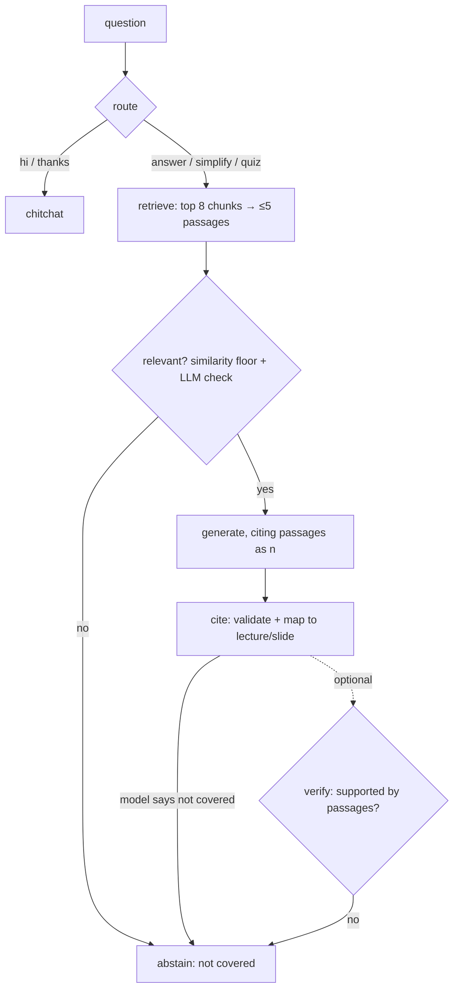

# A Course-Grounded Study Assistant for Applied Generative AI

**Team:** Sowris Kumar Sripathy, Alfonso Garcia · **Code:** https://github.com/SowrisKumar/course-study-assistant

## Abstract

General-purpose chatbots answer course questions fluently. But they cannot say *where in the course* an answer comes from, and they answer just as confidently about topics the course never covered. We built a study assistant that answers only from our course materials (lecture slides, practical notebooks and activity PDFs), cites the lecture and slide/section for every answer, and says *"This isn't covered in the course materials"* otherwise. It can also explain a topic simply or write a practice quiz. It is a RAG pipeline inside a LangGraph workflow, running on a local Llama 3.1 8B.

On 50 new evaluation questions it compared with the same model without the materials as follows:

| | With the course materials | Same model, without them |
|---|---|---|
| Covered questions answered correctly | **97%** | 55% |
| Answers citing the right lecture | **97%** | — |
| Uncovered questions declined | **92%** | 33% |
| Uncovered topics that *sound* like course content, declined | **90%** | 20% |

The evaluation also showed two things that matter beyond this project:
- **An 8B LLM is an unreliable grader**, in both directions.
- **The most dangerous failure is a confident answer with citations that don't support it.**

Section 7 tests a fix for the second, a support check. It removes most flawed answers but also some correct ones, so it is offered as an option rather than the default.

---

## 1. Problem and goals

The proposal (midterm, `docs/proposal.png`) set out five goals. We kept all of them and made each one measurable:

1. **Answer only from the course materials.**
2. **Show which lecture the answer came from.** We cite at the level of lecture + slide / notebook section / page, not just the file name.
3. **Say "not covered" instead of guessing.**
4. **Explain a topic more simply, and make a short practice quiz.**
5. **Evaluate on ~50 questions with known answers** (correctness, citations, admitting ignorance) against a chatbot that can't see the materials.

FastAPI + Docker deployment was moved to the end (Section 10).

## 2. What we used from the class

| Course material | Where it shows up |
|---|---|
| `shared/research_ingest.py` | Chunking, sentence-transformer embeddings (`all-MiniLM-L6-v2`), citation metadata on every chunk |
| `RAG_primer_fast.ipynb` | TF-IDF retrieval (one of our four retrievers) and the 5 stages of RAG |
| `campus_help_desk_rag.ipynb`, `langgraph_intro.ipynb` | The LangGraph `StateGraph` pattern: router → nodes → conditional edges, plus a "don't know" fallback |
| `M3_Prompting_Strategies_colab.ipynb`, Lecture 3 | Structured prompting: system prompts with explicit rules and fixed output formats (`RELEVANT: 1, 3`, `SCORE: 2`) |
| `llm_evals.ipynb`, `llm_as_judge_solution.ipynb` | Evaluation tiers: rules (key facts) → LLM-as-judge, and the warning that judges are unreliable, which we confirmed |
| Lectures 2, 3, 9 | Embeddings, RAG vs fine-tuning, transformers (the models we use) |
| `Module 1 Custom Setup Guide` | `uv` project management, as used in this repo |

## 3. Knowledge base (Step 1)

We turned 47 course files into **507 documents**, each a natural unit with citation metadata (`src/study_assistant/ingest/`):

| Source | One document = | Handling |
|---|---|---|
| 11 slide decks (`.pptx`) | a slide | title, text boxes, tables, speaker notes; slide-number fields removed |
| 28 notebooks | an *explanation + its code* section, with a heading breadcrumb | outputs and `pip install` lines dropped |
| 7 PDFs (activities, setup guide) | a page | PyMuPDF in reading order; headers, footers, URLs and page counters removed |
| `module10_rl_slides.pdf` (28 slides, **images only**) | a slide | OCR (RapidOCR); the layout is rebuilt so side-by-side boxes aren't interleaved |

**Problems found and fixed while building it:**
- **Notebook and lecture numbering don't match.** For example, `Module_4_Practical_VAE.ipynb` is the practical for **Lecture 5**. An explicit catalogue maps each notebook to its lecture by content, so citations point students to the right lecture.
- **pypdf removed spaces in code** (`importtorch.nnasnn`), so we switched to PyMuPDF.
- **Position-based reading order** was needed to keep each code listing next to its heading.
- **43 title and section-divider slides** are flagged and kept out of the index, so they don't out-rank the slides that explain the topic.

The knowledge base ships with the repo (`data/processed/documents.jsonl`); the raw course files do not.

**Limitations:**
- Equations and diagrams that are images are lost (e.g. the VAE loss formula).
- OCR approximates Greek letters.

## 4. Retrieval (Step 2)

**Chunking.** The embedding model reads at most 256 tokens, but 185 of 249 notebook sections were longer (up to 4,800 tokens). So we split them on paragraph and code-block boundaries, sized with the model's own tokenizer. Each chunk gets a `title › section` header, because a code fragment means more when labelled "VAE › Training". The result is **1,202 chunks**: none over the limit, and no text lost (both tested).

**Four retrievers, one interface:**
- **TF-IDF** (class primer)
- **BM25**
- **Dense** (MiniLM embeddings)
- **Hybrid**: BM25 + dense with Reciprocal Rank Fusion

On 30 development questions with grep-verified answers, keyword search was perfect when the question used the course's term but fell apart on paraphrases. **hit@5 on paraphrases:**

| TF-IDF | BM25 | Dense | Hybrid |
|---|---|---|---|
| 50% | 80% | **90%** | 70% |

A student who doesn't know the term needs meaning-based retrieval.

**Key finding: similarity can't tell "covered" from "not covered".** "Capital of France" scored about as high as the weakest real question, and the near-miss "mode collapse" scored above seven real questions. That motivated an LLM relevance check rather than a threshold.

## 5. The assistant (Steps 3–4)

**LLM backends.** One interface, `generate(prompt, system)`, with four backends:
- OpenAI
- Gemini (free tier)
- Ollama / Llama 3.1 8B (local, used for all results)
- flan-t5 (the class model, as a weak baseline)

All run at temperature 0, which we verified gives reproducible answers. Rate limits are retried with backoff.

**The workflow** (`assistant.py`, LangGraph):



| Node | What it does |
|---|---|
| route | Rule-based (like the class router): quiz / simplify / chitchat / answer. Only explicit phrases trigger "simplify", so "simple RNNs" stays a normal question. |
| retrieve | Hybrid retrieval. Chunks of the same document are merged so each source is cited once. |
| check | A cosine floor drops obvious off-topic questions with no LLM call. One LLM call then grades all passages (`RELEVANT: 1, 3`). |
| generate | Mode-specific prompt: only the passages; cite `[n]` after each fact; reply exactly with the "not covered" sentence if the passages are insufficient. |
| cite | Citations to passages that weren't shown are dropped and the rest renumbered. They are mapped to labels like "Lecture 9 · Module 9 – Transformer Architecture…, slide 6". Answers with no citation are flagged. |
| verify | Optional support check, off by default (Section 7). |

So the assistant has two independent abstention layers, the relevance check and the answer prompt. Early testing showed both are needed: the 8B relevance check let irrelevant passages through for "capital of France".

Try it: `uv run python -m study_assistant.chat -v`.

## 6. Evaluation (Step 5)

**Questions.** We wrote 50 new questions (`eval/QUESTIONS.md`); none are reused from development:

| Type | Count |
|---|---|
| Answerable, using the course's terms | 30 |
| Answerable, paraphrased | 8 |
| Not covered: near-misses that sound like course topics (PPO, DPO, GRPO, VQ-VAE, Stable Diffusion, MoE, FID, L1/L2, vanishing gradients) | 9 |
| Not covered: a trap ("Everest" appears in toy demo data, but no boiling point) | 1 |
| Not covered: off-topic | 2 |

Every reference answer was written from the cited slide. Tests check that every key fact appears in the right lecture and that no uncovered topic appears anywhere in the course. Those checks caught two mistakes in our own first draft.

**Systems.**
- RAG vs no-RAG for Llama 3.1 8B and for flan-t5-base.
- RAG + Llama with dense and with hybrid retrieval.
- The no-RAG baseline gets the same "you are the course's study assistant; say not covered if…" prompt, but no materials.

**Metrics.**
- **Abstention:** the share of not-covered questions declined, and the share of covered questions wrongly declined.
- **Citations:** whether answers cite the right lecture.
- **Correctness**, over all 38 covered questions (a refusal counts as wrong). It combines tier 1, key-fact recall, with tier 4, LLM-as-judge.

**The grader had to be fixed.** Llama 3.1 8B graded the answers.
- **Version 1 (reference answer only)** marked down correct course details that our short references omitted. We checked six such cases: all six are in the course text, e.g. the diffusion practical's `denoise(noisy_images, noise_rates, signal_rates)`. This biased the comparison *against* RAG.
- **Version 2** also shows the grader the most relevant excerpts of the gold lecture, identically for all systems. It was then **too lenient on one-word answers** (flan-t5's "squeeze" got full marks).
- **So "correct" requires both** the grader's verdict *and* at least half the key facts. The grader was also inconsistent (the same wrong clause scored differently in two runs), so close comparisons were read by hand.

### Results


| | Llama + course (hybrid) | Llama + course (dense) | Llama, no course | flan-t5 + course | flan-t5, no course |
|---|---|---|---|---|---|
| Correct | **97%** | 82% | 55% | 32% | 0% |
| Key facts present | 96% | 92% | 72% | 35% | 2% |
| Covered questions wrongly refused | 0% | 5% | 3% | 5% | 50% |
| Not covered → declined | **92%** | 83% | 33% | 67% | 58% |
| Near-miss → declined | **90%** | 80% | 20% | 60% | 70% |
| Cites the right lecture | 97% | 100% | — | (2 answers cited) | — |
| Seconds per question (M2 laptop) | 14 | 13 | 7 | 1 | 1 |

**What the results show:**
- **The course materials make the assistant both more correct and more honest.** The model *without* them answers 8 of the 10 near-miss and trap questions confidently (PPO, DPO, FID, …). A student would wrongly believe those topics were taught. It also refuses the one question only the course can answer (the MIT/Stanford productivity study).
- **Hybrid vs dense.** We read the 8 questions where they differ by hand: hybrid really wins 4 and loses 1, and the other 3 are grader noise. Hybrid is now the default. Because it was chosen on this set, its numbers are slightly optimistic; dense is the unselected baseline.
- **Retrieval is not the bottleneck here.** Every method finds the right lecture in its top 3 for all 38 questions, so the remaining errors come from generation.
- **flan-t5 is too small for this task.** RAG lifts it from 0% to 32%, but it writes a few words and almost never cites.

**Failure analysis.** The most important failure is **confident answers with citations that don't support them**. For "vanishing gradients" and (dense) "Stable Diffusion":
1. The relevance check accepted loosely related passages (the gradient slide; the VAE and diffusion practicals).
2. Llama answered from its own knowledge and cited those passages.

The citations make this look trustworthy, which is worse than an uncited answer. Smaller errors:
- one subtly wrong definition
- generic answers that miss the course's specific point
- over-cautious refusals when the right material was retrieved (dense only)

## 7. Improvement: a support check (Step 6)

**Idea.** This is a self-check after answering, like the reflection step in the class agentic-workflow labs. The LLM re-reads the answer next to the passages and says whether its main content is actually stated there. If not, the assistant declines.

**Method (avoiding tuning on the test set).**
- All trying-out used the 35 *development* questions from Step 2.
- To keep this fast and fair, it ran on **saved answers**. Retrieval is deterministic, and the relevance verdicts are in the saved traces, so each answer's passages could be rebuilt exactly.
- The variant applied to the evaluation set was fixed *before* looking at evaluation results. Script and outputs: `eval/support_check/`.

**The development set fixed two real bugs before any result was taken.**
1. **The check must see *all* passages the model was shown**, with citation numbers stripped. A correct answer drew on slide 5 but cited only slide 6, and was wrongly rejected.
2. **The "not covered" sentence must be detected anywhere in the reply.** Llama sometimes wrote a general-knowledge hedge first ("…not explicitly mentioned. However, typically…") and only then the sentence. The fix applies always, not only with the check on. It changed none of the saved Step 5 results.

**Results.**

| | Development (27 answered, none out of scope) | Evaluation, dense run | Evaluation, hybrid run |
|---|---|---|---|
| Unsupported out-of-scope answers removed | (none to catch) | **1 of 2** (Stable Diffusion) | 0 of 1 |
| Flawed covered answers removed | — | **2** (q02 and q11, both known wrong) | 1 (q02: the same wrong clause the grader missed) |
| Correct answers wrongly removed | **3 (11%)**; the "concept" variant also rejected 3 | 1 (q23) | 0 |

**Reading it.**
- **It works as a precision filter.** Most of what it removes really is flawed, including answers the grader had passed.
- **But it costs correct answers:** 11% on development.
- **It still misses the "vanishing gradients" answer.** That answer genuinely paraphrases the course's gradient slide before adding its own knowledge, so judging it is hard for an 8B checker.

It is therefore **off by default and available as an option** (`chat --verify`, `StudyAssistant(verify=True)`) for anyone who prefers a refusal to a possibly flawed answer. Closing this gap properly most likely needs a stronger checker model than the 8B one running locally. Checking sentence by sentence rather than the whole answer is a second option.

## 8. Limitations

- **Small test set:** 38 + 12 questions, so one question moves a score by 2.6 / 8 points.
- **The grader is the same 8B model as the answerer.** It is noisy, hence the combined metric and hand-checked comparisons. A stronger, independent grader (Gemini or GPT; both are supported by the code) would make the numbers more trustworthy.
- **Hybrid retrieval was selected on the evaluation set.**
- **The paraphrased evaluation questions were easier** than the development ones.
- **The questions and reference answers were drafted with AI assistance** and checked automatically against the course text, but not independently reviewed by a second person.
- **Image-only content (equations, diagrams) is not in the knowledge base.**
- **Speed:** about 14 s per answer on a laptop with a local 8B model. A cloud model would be faster and likely more accurate, at a cost.

## 9. How to run

```bash
git clone https://github.com/SowrisKumar/course-study-assistant.git && cd course-study-assistant
uv sync && uv run pytest                        # 100+ tests
ollama pull llama3.1:8b                         # local model (or add a Gemini/OpenAI key to .env)
uv run python -m study_assistant.chat -v        # chat with the assistant
uv run python -m study_assistant.evaluation --backend ollama   # reproduce the evaluation
```

Notebooks `01`–`05` walk through each step with their outputs, and `docs/design.md` logs every decision.

## 10. Future work

- **FastAPI endpoint + Docker image** on the same package (the class `sps_genai` pattern), as in the proposal.
- **A stronger, independent grader**, and a second human reviewer for the question set.
- **Caption image-only slides** (equations, diagrams) with a vision model, so they become searchable.
- **Harder paraphrase questions**, and merging rank-fusion votes per notebook section (split sections caused one hybrid miss on the development set).
- **Multi-turn conversation memory** for follow-up questions.
