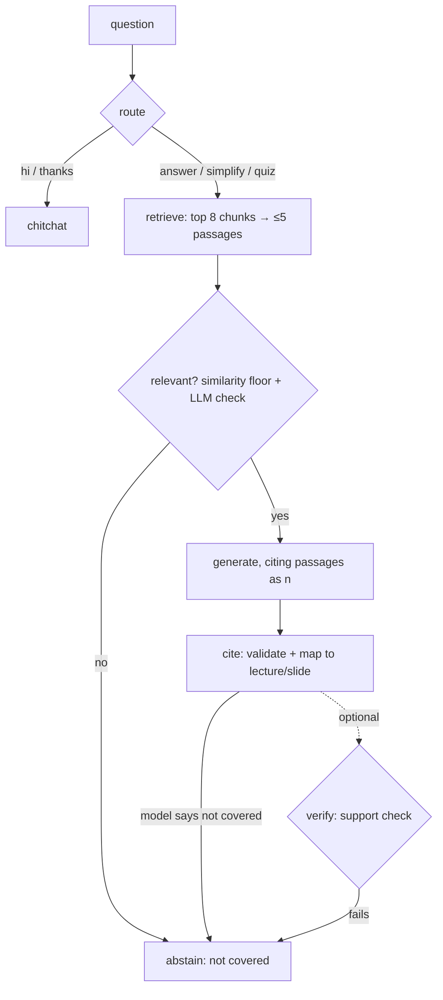
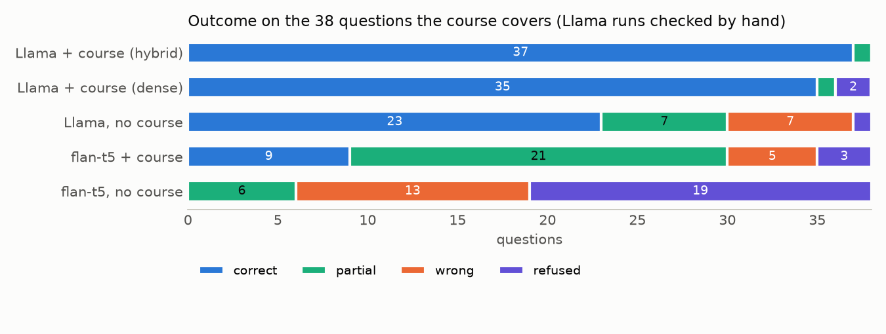

# A Course-Grounded Study Assistant for Applied Generative AI

**Team:** Sowris Kumar Sripathy, Alfonso Garcia · **Code:** https://github.com/SowrisKumar/course-study-assistant

## Abstract

General-purpose chatbots answer course questions fluently. But they cannot say *where in the course* an answer comes from, and they answer just as confidently about topics the course never covered. We built a study assistant that answers only from our course materials (lecture slides, practical notebooks and activity PDFs), cites the lecture and slide/section for every answer, and says *"This isn't covered in the course materials"* otherwise. It can also explain a topic simply or write a practice quiz. It is a RAG pipeline inside a LangGraph workflow, running on a local Llama 3.1 8B.

On 50 new evaluation questions (38 the course covers, 12 it doesn't), compared with the same model without the materials:

| | With the course materials | Same model, without them |
|---|---|---|
| Covered questions answered correctly (checked by hand) | **97%** (37/38) | 61% (23/38) |
| …by the automatic metric alone | 95% | 47% |
| Answers citing the right lecture | **97%** | — |
| Uncovered questions declined | **100%** (12/12) | 33% (4/12) |
| …of which topics that *sound* like course content (near-misses + a trap) | **100%** (10/10) | 20% (2/10) |

Over all 50 questions the assistant handled 49 correctly and the plain model 27. The two disagree on 24 questions and the assistant wins 23 of them (exact McNemar test, p < 0.001). With this few questions every rate has a wide interval, e.g. 87–100% for the 97% (Section 6).

Three findings matter beyond this project:
- **An 8B LLM is an unreliable grader**, in both directions. We had to redesign the grading, and still read every failed answer by hand.
- **Our LLM relevance check did nothing measurable.** It never declined a question; all abstentions came from the answer prompt and a similarity floor. Turning it off gave the same results.
- **A post-hoc support check found nothing left to catch on the evaluation set** (Section 7). Our first assessment of its two variants was wrong until we labelled the development answers by hand.

---

## 1. Problem and goals

The proposal (midterm, `docs/proposal.png`) set out five goals. We kept all of them and made each one measurable:

1. **Answer only from the course materials.**
2. **Show which lecture the answer came from.** We cite at the level of lecture + slide / notebook section / page, not just the file name.
3. **Say "not covered" instead of guessing.**
4. **Explain a topic more simply, and make a short practice quiz.**
5. **Evaluate on ~50 questions with known answers** (correctness, citations, admitting ignorance) against a chatbot that can't see the materials.

FastAPI + Docker deployment was moved to the end (Section 10).

## 2. What we used from the class

| Course material | Where it shows up |
|---|---|
| `shared/research_ingest.py` | Chunking, sentence-transformer embeddings (`all-MiniLM-L6-v2`), citation metadata on every chunk |
| `RAG_primer_fast.ipynb` | TF-IDF retrieval (one of our four retrievers) and the 5 stages of RAG |
| `campus_help_desk_rag.ipynb`, `langgraph_intro.ipynb` | The LangGraph `StateGraph` pattern: router → nodes → conditional edges, plus a "don't know" fallback |
| `M3_Prompting_Strategies_colab.ipynb`, Lecture 3 | Structured prompting: system prompts with explicit rules and fixed output formats (`RELEVANT: 1, 3`, `SCORE: 2`) |
| `llm_evals.ipynb`, `llm_as_judge_solution.ipynb` | Evaluation tiers: rules (key facts) → LLM-as-judge, and the warning that judges are unreliable, which we confirmed |
| Lectures 2, 3, 9 | Embeddings, RAG vs fine-tuning, transformers (the models we use) |
| `Module 1 Custom Setup Guide` | `uv` project management, as used in this repo |

## 3. Knowledge base (Step 1)

We turned 48 course files into **538 documents**, each a natural unit with citation metadata (`src/study_assistant/ingest/`):

| Source | One document = | Handling |
|---|---|---|
| 11 slide decks (`.pptx`) | a slide | title, text boxes, tables, speaker notes; slide-number fields removed |
| 28 notebooks | an *explanation + its code* section, with a heading breadcrumb | outputs and `pip install` lines dropped |
| 7 PDFs (activities, setup guide) | a page | PyMuPDF in reading order; headers, footers, URLs and page counters removed |
| 2 extended decks for Lectures 10 and 11 (28 + 31 slides, **images only**) | a slide | OCR (RapidOCR); the layout is rebuilt so side-by-side boxes aren't interleaved |

**Problems found and fixed while building it:**
- **Notebook and lecture numbering don't match.** For example, `Module_4_Practical_VAE.ipynb` is the practical for **Lecture 5**. An explicit catalogue maps each notebook to its lecture by content, so citations point students to the right lecture.
- **pypdf removed spaces in code** (`importtorch.nnasnn`), so we switched to PyMuPDF.
- **Position-based reading order** was needed to keep each code listing next to its heading.
- **43 title and section-divider slides** are flagged and kept out of the index, so they don't out-rank the slides that explain the topic.
- **The extended Lecture 11 deck was missing at first.** An independent audit of the project found it. It matters: it names PPO, which one of our "not covered" questions had asked about (Section 6).

The knowledge base ships with the repo (`data/processed/documents.jsonl`); the raw course files do not.

**Limitations:**
- Equations and diagrams that are images are lost (e.g. the VAE loss formula).
- OCR approximates Greek letters.

## 4. Retrieval (Step 2)

**Chunking.** The embedding model reads at most 256 tokens, but 185 of 249 notebook sections were longer (up to 4,800 tokens). So we split them on paragraph and code-block boundaries, sized with the model's own tokenizer. Each chunk gets a `title › section` header, because a code fragment means more when labelled "VAE › Training". The result is **1,237 chunks**: none over the limit, and no text lost (both tested).

**Four retrievers, one interface:**
- **TF-IDF** (class primer)
- **BM25**
- **Dense** (MiniLM embeddings)
- **Hybrid**: BM25 + dense with Reciprocal Rank Fusion

On 30 development questions with grep-verified answers, keyword search was perfect when the question used the course's term but fell apart on paraphrases. **hit@5 on paraphrases:**

| TF-IDF | BM25 | Dense | Hybrid |
|---|---|---|---|
| 60% | 80% | **100%** | 80% |

A student who doesn't know the term needs meaning-based retrieval.

**Key finding: similarity can't tell "covered" from "not covered".** "Capital of France" scored *above* the weakest real question (0.43 vs 0.37), because the extended Lecture 11 deck uses it as an example prompt. The near-miss "mode collapse" scored above six real questions. That motivated an LLM relevance check rather than a threshold. Section 6 shows that check did not help in practice.

## 5. The assistant (Steps 3–4)

**LLM backends.** One interface, `generate(prompt, system)`, with four backends:
- OpenAI
- Gemini (free tier)
- Ollama / Llama 3.1 8B (local, used for all results)
- flan-t5 (the class model, as a weak baseline)

All run at temperature 0, which we verified gives reproducible answers. Rate limits are retried with backoff.

**The workflow** (`assistant.py`, LangGraph):



| Node | What it does |
|---|---|
| route | Rule-based (like the class router): quiz / simplify / chitchat / answer. Only explicit phrases trigger "simplify", so "simple RNNs" stays a normal question. |
| retrieve | Hybrid retrieval. Chunks of the same document are merged so each source is cited once. |
| check | A cosine floor drops obvious off-topic questions with no LLM call. One LLM call then grades all passages (`RELEVANT: 1, 3`). |
| generate | Mode-specific prompt: only the passages; cite `[n]` after each fact; reply exactly with the "not covered" sentence if the passages are insufficient. |
| cite | Citations to passages that weren't shown are dropped and the rest renumbered; code such as `outputs[0]` is left alone. Citations are mapped to labels like "Lecture 9 · Module 9 – Transformer Architecture…, slide 6". Answers with no citation are flagged. |
| verify | Optional support check, off by default (Section 7). |

Try it: `uv run python -m study_assistant.chat -v`.

## 6. Evaluation (Step 5)

**Questions.** We wrote 50 new questions (`eval/QUESTIONS.md`); none are reused from development:

| Type | Count |
|---|---|
| Answerable, using the course's terms | 30 |
| Answerable, paraphrased | 8 |
| Not covered: near-misses that sound like course topics (label smoothing, PPO's clipped objective, VQ-VAE, Stable Diffusion, MoE, FID, L1/L2, DPO, GRPO) | 9 |
| Not covered: a trap ("Everest" appears in toy demo data, but no boiling point) | 1 |
| Not covered: off-topic | 2 |

Every reference answer was written from the cited slide. Tests check three things:
- every key fact appears in the right lecture
- no key fact just repeats the question
- no uncovered topic appears anywhere in the course

Those checks caught mistakes in our own drafts. After the audit we also replaced one near-miss that the course half-covered (vanishing gradients) and tightened 11 key-fact lists.

**Systems.**
- RAG vs no-RAG for Llama 3.1 8B and for flan-t5-base.
- RAG + Llama with dense and with hybrid retrieval.
- Two ablations of the main system: the relevance check turned off, and the support check turned on (Section 7).
- The no-RAG baseline gets the same "you are the course's study assistant; say not covered if…" prompt, but no materials.

**Metrics.**
- **Abstention:** the share of not-covered questions declined, and the share of covered questions wrongly declined.
- **Citations:** whether answers cite the right lecture.
- **Correctness**, over all 38 covered questions (a refusal counts as wrong). It combines tier 1, key-fact recall, with tier 4, LLM-as-judge.

**The grader had to be fixed.** Llama 3.1 8B graded the answers.
- **Version 1 (reference answer only)** marked down correct course details that our short references omitted. We checked six such cases: all six are in the course text, e.g. the diffusion practical's `denoise(noisy_images, noise_rates, signal_rates)`. This biased the comparison *against* RAG.
- **Version 2** also shows the grader the most relevant excerpts of the gold lecture, identically for all systems. It was then **too lenient on one-word answers** (flan-t5's "squeeze" got full marks).
- **So the main metric requires both** the grader's verdict *and* at least half the key facts.
- **This metric was designed after we had seen first results**, so it is not a pre-registered measure. We report all three versions side by side below.

**Hand check.** The grader was also inconsistent: two nearly identical answers to q02 (hybrid and dense runs) scored 2 and 1. So we re-read, against the reference and the lecture, **every answer the main metric marked as not correct**, for all Llama configurations. We also re-read all answers it marked correct for the main system and the no-course baseline; none of those were overturned. Every verdict and its reason is in `eval/hand_labels.json`. We are the system's developers, so this check is not blind.

### Results



| | Llama + course (hybrid) | Llama + course (dense) | Llama, no course | flan-t5 + course | flan-t5, no course |
|---|---|---|---|---|---|
| **Correct, checked by hand** | **97%** | 92% | 61% | — | — |
| Correct, main metric (v2 + key facts) | 95% | 79% | 47% | 24% | 0% |
| Correct, judge v2 alone | 100% | 84% | 58% | 55% | 13% |
| Correct, judge v1 alone | 82% | 71% | 45% | 16% | 0% |
| Key facts present | 88% | 86% | 62% | 30% | 0% |
| Covered questions wrongly refused | 0% | 5% | 3% | 8% | 50% |
| Not covered → declined (12) | **100%** | 92% | 33% | 67% | 50% |
| Near-miss or trap → declined (10) | **100%** | 90% | 20% | 60% | 60% |
| Cites the right lecture | 97% | 100% | — | (3 answers cited) | — |
| Seconds per question (M2 laptop) | 14 | 13 | 7 | 1 | <1 |

Hand-corrected scores with 95% Wilson intervals, and paired tests against the main system over all 50 questions (an answerable question counts if answered correctly, a not-covered one if declined). Produced by `eval/analysis.py`:

| | Correct (38) | Declined (12) | All 50 | vs main: main wins / loses | exact McNemar p |
|---|---|---|---|---|---|
| **Main: Llama + course, hybrid** | 97% [87–100] | 100% [76–100] | 98% [90–100] | — | — |
| Llama + course, dense | 92% [79–97] | 92% [65–99] | 92% [81–97] | 4 / 1 | 0.38 |
| Relevance check off | 97% [87–100] | 100% [76–100] | 98% [90–100] | 1 / 1 | 1 |
| Llama, no course | 61% [45–74] | 33% [14–61] | 54% [40–67] | 23 / 1 | < 0.001 |

**What the results show:**
- **The course materials make the assistant both more correct and more honest.** This is the one difference the test set is large enough to establish. The model *without* the materials confidently answers 8 of the 10 near-miss and trap questions (PPO, DPO, FID, …), so a student would wrongly believe those topics were taught. It also refuses the one question only the course can answer (the MIT/Stanford productivity study), and gets course-specific facts wrong (Conda instead of `uv`; invented evaluation "tiers").
- **The automatic metric under-counts every system,** by 1 question (main) to 5 (dense, no course). Most misses are key-fact lists too strict for a correct paraphrase. The ranking of systems is the same either way.
- **Hybrid vs dense is not resolved by this test set.** Hybrid wins 4 questions and loses 1 (p = 0.38). Hybrid is the default because it never wrongly refused, but it was chosen on these questions, so its numbers are slightly optimistic. Dense is the unselected baseline.
- **The LLM relevance check did nothing measurable.** In every Llama run it accepted at least one passage for every question; it never declined. All 12 abstentions came from the similarity floor (the 2 off-topic questions) and the answer prompt (the 10 others). With the check turned off, the results were the same within one question each way: one answer got better, one worse. It costs one LLM call per question (14 vs 10 s per answer).
- **Retrieval is not the bottleneck here.** Both retrievers put the right lecture (or lab) in the top 3 passages for all 38 covered questions, so the remaining errors come from generation.
- **flan-t5 is too small for this task.** RAG lifts it from 0% to 24%, but it writes a few words and almost never cites. Its runs were not hand-checked.

**Failure analysis.** The main system's remaining failure is a **generic answer** that misses the course's specific point. For q19 (class-conditional GANs) it says to "condition on the label" but not how the course does it (one-hot labels to the generator *and* the critic). The other configurations show three more kinds of failure:
- **A confident answer with citations that don't support it** (dense, "Stable Diffusion"). The passages about VAEs and the diffusion practical were accepted as relevant, Llama answered from its own knowledge, and it cited them. This looks trustworthy, which is worse than an uncited answer. Before the audit the same thing happened for "vanishing gradients", which turned out to be half covered by the course; we replaced that question.
- **Subtly wrong details** (dense: "reshape might copy even if the memory is contiguous"; relevance check off: "upsampling layer" instead of transposed convolution).
- **Over-cautious refusals** with the right material in hand (dense: q17, q30).

## 7. Improvement: a support check (Step 6)

**Idea.** This is a self-check after answering, like the reflection step in the class agentic-workflow labs. A second LLM call checks the answer against the passages, and if the check fails the assistant declines. We tried two variants:
- **strict:** "Is the main content of the answer actually stated in the passages?"
- **concept:** "Do the passages discuss the specific concept the question asks about?" This variant ignores the answer. It targets our worst failure, an answer about something the course never discusses, with citations to loosely related passages.

**Method (avoiding tuning on the test set).**
- All trying-out used the 35 *development* questions from Step 2, on saved answers. Retrieval is deterministic and the relevance verdicts are in the saved traces, so each answer's passages could be rebuilt exactly. Script and outputs: `eval/support_check/`.
- The development set fixed two real bugs before any evaluation result was taken:
  1. **The check must see *all* passages the model was shown**, with citation numbers stripped. A correct answer drew on slide 5 but cited only slide 6, and was wrongly rejected.
  2. **Hedged refusals must count as refusals.** Llama sometimes wrote a general-knowledge hedge first ("…not explicitly mentioned. However, typically…") and only then the "not covered" sentence. The fix applies always (one shared detector, `refusal.py`).

**We got the development result wrong at first.** Our first write-up counted every rejected development answer as a correct answer lost, and so concluded that both variants cost 3 of 27 correct answers. When we labelled the 27 development answers by hand (`eval/support_check/dev_labels.json`: 22 correct, 2 partial, 3 wrong), the picture reversed:

| | Correct answers rejected | Wrong answers rejected |
|---|---|---|
| strict | 2 | 1 of 3 |
| **concept** | **0** | **3 of 3** |

So concept is the better variant, chosen on development data only. Both were then run on the full evaluation set:

| | Correct (hand) | Not covered → declined | Seconds / question | Changes vs main system |
|---|---|---|---|---|
| Main system (no check) | 97% | 100% | 14 | — |
| strict | 95% | 100% | 18 | rejected 1 correct answer (q02) |
| concept | 97% | 100% | 18 | none |

**Reading it.**
- **On this evaluation set there was nothing left to catch.** The main system already declined all 12 not-covered questions, and its one imperfect answer (q19) is generic, not unsupported. So the check can only cost here: strict lost one correct answer, concept changed nothing.
- **Where the check would matter is dense's Stable Diffusion answer**, the clean example of an unsupported answer with citations. The hybrid system never produced it.
- **Decision: off by default.** It adds about 4 s per answer and made no difference on the evaluation set; the default system is the one evaluated above. It is available as `chat --verify` (concept variant) or `StudyAssistant(verify="concept")` for anyone who prefers a refusal to a possibly unsupported answer. The evidence that it helps is 3 development questions, which is suggestive, not conclusive.

## 8. Limitations and threats to validity

- **Small test set:** 38 + 12 questions, so one question moves a score by 2.6 / 8 points, and only large differences (course vs no course) are statistically clear.
- **The grader is the same 8B model as the answerer.** It is noisy, hence the combined metric and the hand check. A stronger, independent grader (Gemini or GPT; both are supported by the code) would make the numbers more trustworthy.
- **The main metric and the hand check were designed after seeing results,** and the hand labels were made by the developers, not blind.
- **Hybrid retrieval was selected on the evaluation set.**
- **The paraphrased evaluation questions were easier** than the development ones.
- **The questions and reference answers were drafted with AI assistance** and checked automatically against the course text, but not yet reviewed by a second person. Alfonso reviewing `eval/QUESTIONS.md` is the next step.
- **Image-only content (equations, diagrams) is not in the knowledge base.**
- **Speed:** about 14 s per answer on a laptop with a local 8B model. A cloud model would be faster and likely more accurate, at a cost.

## 9. How to run

```bash
git clone https://github.com/SowrisKumar/course-study-assistant.git && cd course-study-assistant
uv sync && uv run pytest                        # 120+ tests; the first run downloads the embedding model
ollama pull llama3.1:8b                         # local model (or add a Gemini/OpenAI key to .env)
uv run python -m study_assistant.chat -v        # chat with the assistant
./scripts/run_evaluation.sh                     # reproduce every evaluation number (~2 h on an M2)
uv run python eval/analysis.py                  # hand-corrected scores, intervals and tests
```

`eval/results/RUN_INFO.md` records the code version, model digest and timings of the run reported here. Every run is also appended to `eval/experiment_log.csv`, one row per build and configuration, so results from different models and versions are kept side by side; notebook `06` charts them (including this project's scores before and after the audit). Notebooks `01`–`06` walk through each step with their outputs, and `docs/design.md` logs every decision.

## 10. Future work

- **FastAPI endpoint + Docker image** on the same package (the class `sps_genai` pattern), as in the proposal.
- **A stronger, independent grader**, and a second human reviewer for the question set.
- **Replace or remove the relevance check:** it adds a model call and, with an 8B model, never declines.
- **Caption image-only slides** (equations, diagrams) with a vision model, so they become searchable.
- **Harder paraphrase questions**, and merging rank-fusion votes per notebook section (split sections caused one hybrid miss on the development set).
- **Multi-turn conversation memory** for follow-up questions.
